# Polyglot Database Design

This document details the data storage architecture of **ChatWeb** across its three dedicated persistence engines: **PostgreSQL (Relational)**, **MongoDB (Document Store)**, and **Redis Stack (In-Memory Data Structures & Filters)**.

---

## 1. Relational Tier: PostgreSQL (RDBMS)

PostgreSQL serves as the authoritative source of truth for user authentication, role-based access control (RBAC), friendship graphs, address records, persistent in-app notifications, and moderation reports.

### 1.1. Entity-Relationship Diagram (ERD)

```mermaid
erDiagram
    ROLES ||--o{ USERS : "assigned_to (role_id)"
    ROLES }o--o{ PERMISSIONS : "includes (role_has_permission)"
    USERS ||--o{ FRIENDSHIPS : "requests (requester_id)"
    USERS ||--o{ FRIENDSHIPS : "receives (addressee_id)"
    USERS ||--o{ ADDRESSES : "owns (user_id)"
    USERS ||--o{ NOTIFICATIONS : "receives (recipient_id)"
    USERS ||--o{ NOTIFICATIONS : "triggers (sender_id)"
    USERS ||--o{ REPORTS : "files (reporter_id)"
    USERS ||--o{ REPORTS : "reported_in (reported_user_id)"
    USERS ||--o{ REPORTS : "resolves (resolved_by_id)"

    USERS {
        bigint id PK
        varchar auth_provider "LOCAL, GOOGLE, FACEBOOK, GITHUB"
        varchar provider_id UK "Nullable"
        varchar username UK "Not Null, Unique"
        varchar password "BCrypt Hash, Not Null"
        varchar email UK "Unique"
        varchar phone "Nullable"
        boolean is_online "Default false"
        varchar user_status "ACTIVE, INACTIVE, LOCKED, UNVERIFIED"
        bigint role_id FK "Not Null"
        varchar first_name "Nullable"
        varchar last_name "Nullable"
        varchar avatar "Cloudinary URL"
        date birthday "Nullable"
        varchar gender "MAN, WOMAN"
        varchar language "Default 'vi'"
        integer token_version "Default 0 - Single Sign-Out"
        timestamp create_at "Creation timestamp"
        timestamp update_at "Auto-updated timestamp"
        bigint version "Default 0 - Optimistic Locking"
    }

    ROLES {
        bigint id PK
        varchar name UK "Not Null, Unique (e.g. ADMIN, USER)"
        varchar description "Human-readable description"
        boolean is_user_role "Default true, Indexed (false for Admin/Staff roles)"
        timestamp create_at "Creation timestamp"
        timestamp update_at "Auto-updated timestamp"
        bigint version "Default 0 - Optimistic Locking"
    }

    PERMISSIONS {
        bigint id PK
        varchar name UK "Not Null, Unique (e.g. ADMIN_VIEW_USERS)"
        varchar description "Permission scope"
        timestamp create_at "Creation timestamp"
        timestamp update_at "Auto-updated timestamp"
        bigint version "Default 0 - Optimistic Locking"
    }

    FRIENDSHIPS {
        bigint id PK
        bigint requester_id FK "Not Null"
        bigint addressee_id FK "Not Null"
        varchar status "PENDING, ACCEPTED, BLOCKED"
        timestamp create_at "Creation timestamp"
        timestamp update_at "Auto-updated timestamp"
        bigint version "Default 0 - Optimistic Locking"
    }

    ADDRESSES {
        bigint id PK
        bigint user_id FK "Nullable, ON DELETE CASCADE"
        varchar house_number "Nullable"
        varchar street "Nullable"
        varchar ward "Nullable"
        varchar district "Nullable"
        varchar city "Not Null"
        varchar country "Not Null"
        varchar postal_code "Nullable (in entity/request; omitted from AddressResponse)"
        timestamp create_at "Creation timestamp"
        timestamp update_at "Auto-updated timestamp"
        bigint version "Default 0 - Optimistic Locking"
    }

    NOTIFICATIONS {
        bigint id PK
        bigint recipient_id FK "Not Null"
        bigint sender_id FK "Nullable, ON DELETE CASCADE"
        varchar type "Not Null (13 types: REQUEST_SENT_SUCCESS, YOU_ACCEPTED, FRIEND_REQUEST, FRIEND_ACCEPTED, UNFRIENDED, REQUEST_CANCELLED, REQUEST_REJECTED, USER_ONLINE, USER_OFFLINE, EDIT_MESSAGE, REVOKE_MESSAGE, REACT_MESSAGE, STATUS_MESSAGE)"
        varchar target_type "Nullable (USER, MESSAGE, CONVERSATION, SYSTEM)"
        varchar target_id "Nullable"
        boolean is_read "Default false"
        text content "Not Null"
        timestamp create_at "Creation timestamp"
        timestamp update_at "Auto-updated timestamp"
        bigint version "Default 0 - Optimistic Locking"
    }

    REPORTS {
        bigint id PK
        bigint reporter_id FK "Not Null"
        bigint reported_user_id FK "Not Null"
        varchar reason "Not Null (SPAM, HARASSMENT, INAPPROPRIATE, IMPERSONATION, OTHER)"
        text details "Nullable"
        varchar status "Not Null (PENDING, RESOLVED, DISMISSED)"
        text resolution_note "Nullable"
        bigint resolved_by_id FK "Nullable"
        timestamp resolve_at "Nullable"
        timestamp create_at "Creation timestamp"
        timestamp update_at "Auto-updated timestamp"
        bigint version "Default 0 - Optimistic Locking"
    }
```

### 1.2. Index Optimization Strategy

- **Table `users` (`UserEntity`)**:
  - `idx_user_status` on `(user_status)`: Accelerates queries filtering active, locked, or unverified accounts.
  - `idx_user_role_id` on `(role_id)`: Speeds up authority loading during JWT authentication filter execution.
  - Unique Constraints/Indexes: `users_username_key` (`username`), `users_email_key` (`email`), `users_provider_id_key` (`provider_id`).
- **Table `roles` (`RoleEntity`) & `permissions` (`PermissionEntity`)**:
  - `idx_role_name` on `(name)` & `idx_permission_name` on `(name)`: Fast deterministic role and permission lookup (`ADMIN`, `USER`, `ADMIN_VIEW_REPORTS`, etc.).
  - `idx_role_is_user_role` on `(is_user_role)`: Accelerates filtering ordinary user roles from privileged admin roles.
- **Table `friendships` (`FriendshipEntity`)**:
  - Unique Constraint `uq_friendship_requester_addressee` on `(requester_id, addressee_id)`: Prevents duplicate friendship requests.
  - Composite Index `idx_friendship_requester_status` on `(requester_id, status)`: Accelerates outgoing friend request lookups.
  - Composite Index `idx_friendship_addressee_status` on `(addressee_id, status)`: Accelerates incoming pending invitation lookups.
- **Table `addresses` (`AddressEntity`)**:
  - `idx_address_user_id` on `(user_id)`: Optimizes user address book lookups.
- **Table `notifications` (`NotificationEntity`)**:
  - `idx_notifications_recipient_create_at_id` on `(recipient_id, create_at DESC, id DESC)`: High-performance composite index supporting keyset cursor pagination for in-app notification queries.
- **Table `reports` (`ReportEntity`)**:
  - `idx_reports_status_create_at` on `(status, create_at DESC)`: Speeds up administrative triage and dashboard queues for pending moderation reports.
  - `idx_reports_reported_user` on `(reported_user_id)`: Accelerates moderation audits against reported accounts.

---

## 2. Document Tier: MongoDB (NoSQL)

MongoDB stores unstructured, high-frequency chat messages, read receipts, and transient administrative broadcasts.

### 2.1. Collection `messages`

Stores one-on-one direct messages, attachments, and reaction metadata.

| Field Name | BSON Type | Constraints & Description |
| :--- | :--- | :--- |
| `_id` | `ObjectId / String` | Unique message identifier. |
| `conversationId` | `String` | Normalized deterministic ID: `{minUsername}_{maxUsername}` (e.g. `alice_bob`). |
| `sender` | `String` | Sender username (Indexed). |
| `recipient` | `String` | Recipient username. |
| `content` | `String` | Message text content (null for pure media). |
| `contentType` | `String` (Enum) | `TEXT`, `IMAGE`, `VIDEO`, `FILE`. |
| `messageType` | `String` (Enum) | `CHAT`, `TYPING`. |
| `color` | `String` | Hex color code for customized chat bubble UI. |
| `replyToId` | `String` | `_id` of the quoted parent message (null if direct message). |
| `fileUrl` | `String` | Cloudinary CDN URL for media attachments. |
| `fileName` | `String` | Original filename of uploaded media. |
| `fileSize` | `Long` | File size in bytes. |
| `timestamp` | `Date / ISODate` | Message creation timestamp. |
| `status` | `String` (Enum) | `SENDING`, `SENT`, `READ`. |
| `isEdited` | `Boolean` | Flag indicating whether the message content has been edited. |
| `isDeleted` | `Boolean` | Soft-deletion flag (revoked message). |
| `isReacted` | `Boolean` | Flag indicating whether emoji reactions exist. |
| `reactions` | `Map<String, String>` | Key-value dictionary of reactions: `{ "username": "emoji" }`. |

#### Compound Indexes:
1. **`conv_msg_time_idx`**: `{ conversationId: 1, messageType: 1, timestamp: -1 }`  
   *Purpose*: High-speed cursor-based pagination of chat history in reverse chronological order.
2. **`unread_msg_idx`**: `{ recipient: 1, messageType: 1, isDeleted: 1, sender: 1 }`  
   *Purpose*: Fast aggregation and counting of unread messages grouped by sender.
3. **`conv_content_time_idx`**: `{ conversationId: 1, messageType: 1, isDeleted: 1, timestamp: -1 }`  
   *Purpose*: Keyword searching within active (non-deleted) conversation messages.
4. **`sender_idx`**: `{ sender: 1 }`  
   *Purpose*: Accelerates user activity and message existence queries.

---

### 2.2. Collection `read_receipts`

Implements monotonic watermark tracking for user read positions.

| Field Name | BSON Type | Constraints & Description |
| :--- | :--- | :--- |
| `_id` | `String` | Unique receipt identifier: `{conversationId}:{username}`. |
| `conversationId` | `String` | Canonical conversation identifier (Indexed). |
| `username` | `String` | Reader username (Indexed). |
| `lastReadTimestamp` | `Date / ISODate` | Monotonically updated read watermark timestamp. |
| `lastReadMessageId` | `String` | Identifier of the last message consumed by reader. |

#### Indexes:
- **`conv_user_idx`**: `{ conversationId: 1, username: 1 }`, `unique: true`  
  Guarantees exactly one watermark record per user per conversation.
- **`conversationId_idx`**: `{ conversationId: 1 }`
- **`username_idx`**: `{ username: 1 }`

---

### 2.3. Collection `system_message`

Stores administrative broadcast announcements and world chat messages with automated lifecycle expiration.

| Field Name | BSON Type | Constraints & Description |
| :--- | :--- | :--- |
| `_id` | `String` | Unique message identifier. |
| `sender` | `String` | Admin username who published announcement or sender of world chat message. |
| `type` | `String` (Enum) | `ANNOUNCEMENT` (default, administrative announcement) or `WORLD_CHAT` (world chat messages, TTL 24h). |
| `content` | `String` | Message text content. |
| `timestamp` | `Date / ISODate` | Publication timestamp. |
| `expiresAt` | `Date / ISODate` | Timestamp after which the message is automatically purged by MongoDB (TTL Indexed). |

#### Indexes:
- **`expiresAt_ttl_idx`**: `{ expiresAt: 1 }`, `expireAfterSeconds: 0`  
  MongoDB background TTL thread automatically purges expired announcements and 24-hour world chat records without application intervention.

---

### 2.4. Automated Schema, Index & Seed Initialization (`DataSeeder.java`)

Instead of requiring manual script execution (`init-mongo.js` / `initdb.sql`), ChatWeb delegates all database schema creation, compound index construction, and baseline data seeding to automated Spring Boot application startup routines:

1. **JPA & Spring Data Index Lifecycle**:
   - **PostgreSQL**: Managed via Hibernate (`spring.jpa.hibernate.ddl-auto: update` in `dev` profile) based on JPA `@Table(indexes = ...)` annotations.
   - **MongoDB**: Managed via Spring Data MongoDB (`spring.data.mongodb.auto-index-creation: true` in `dev` profile) parsing `@CompoundIndex` and `@Indexed` annotations on domain models.
2. **Purging Redundant Legacy Mongo Indexes (`DataSeeder.dropLegacyMongoIndexes()`)**:
   - On startup, the system inspects existing indexes on the `messages` collection and automatically drops legacy single-field indexes `recipient_1` and `conversationId_1` which were made redundant by composite index `conv_msg_time_idx`.
3. **RBAC, System Accounts & Cuckoo Filter Seeding (`DataSeeder.run()`)**:
   - Seeds 23 granular authorities and 2 core roles: `ADMIN` (`is_user_role = false`) and `USER` (`is_user_role = true`).
   - Seeds the default administrator account (`admin`) if missing.
   - Re-populates existing database usernames and emails into Redis Cuckoo Filters (`filter:usernames`, `filter:emails`) to ensure in-memory preflight protection remains intact across restarts.
4. **Restart Online Presence Cleanup (`DataSeeder.cleanupOnlineStatus()`)**:
   - Evaluates the size of the Redis Sorted Set `online_users`. If size is 0 (indicating a full cluster restart), it issues a bulk reset setting `is_online = false` in PostgreSQL for any stale records and flushes residual keys (`online_users`, `online_users_count`, `presence:offline_queue`, `ws:routing:servers:*`).

---

## 3. In-Memory Tier: Redis Stack

Redis Stack serves as the ultra-fast distributed coordinating fabric across all backend instances.

### 3.1. Master Redis Key Catalog

| Key Pattern | Data Structure | TTL | Purpose & Usage |
| :--- | :--- | :--- | :--- |
| `kafka:dedup:{consumer}:{eventId}` | **String** | **10m** (`chat_push`, `friend_push`, `message_push_update`) / **24h** (`email`) | Set via `SETNX` (`"COMPLETED"`) in `ConsumerDeduplicationService` to prevent duplicate Kafka event processing across rebalances and retries. |
| `online_users` | **Sorted Set (ZSet)** | Persistent | Holds usernames of currently online users. `score` = Epoch timestamp of latest ping/connect. |
| `online_users_count` | **Hash** | Persistent | Field: `username`, Value: integer count of active WebSocket tabs/sessions. |
| `presence:offline_queue` | **Sorted Set (ZSet)** | Transient | Distributed debounce queue. `score` = Epoch timestamp deadline (`now + 5000ms`). Polled by `SessionCleanupScheduler`. |
| `ws:routing:servers:{username}` | **Hash** | Persistent | Field: `serverId`, Value: active session count on that specific backend instance. |
| `channel:server:{serverId}` | **Pub/Sub Channel** | N/A (Stream) | Dedicated channel for cross-server WebSocket frame forwarding. |
| `ws:dedup:{sender}:{localId}` | **String** | **300 seconds** | Set via `SETNX`. Prevents duplicate STOMP message execution during network retries. |
| `chat:recent:hash:{convId}` | **Hash** | **1 hour (3600s ±300s jitter)** | Caches full metadata of recent messages (capped at 50 messages per conversation) for fast conversation list rendering. |
| `chat:recent:zset:{convId}` | **Sorted Set (ZSet)** | **1 hour (3600s ±300s jitter)** | Stores recent message IDs with `score` = timestamp (capped at 50 messages) for fast ID range slicing. |
| `read_receipt:{convId}:{username}`| **String** | **7 days** | Caches latest read watermark timestamp for fast frontend synchronization. |
| `unread_counts:{username}` | **Hash** | **7 days fallback TTL + jitter** | Caches unread message counts per conversation partner. Evicted upon read receipt upsert. |
| `notif:unread:{username}` | **String** | **10 minutes** (Evicted on change)| Caches unread notification count badge for the user (`NotificationServiceImpl`). |
| `relation:{user1}:{user2}` | **String** | **1 hour (NONE), 1 day (PENDING), 7 days (ACCEPTED/BLOCKED)** | Caches friendship status (`ACCEPTED`, `PENDING:<requester>`, `BLOCKED:<blocker>`, `NONE`) with alphabetically sorted usernames. |
| `blacklist:{token}` | **String** | Remaining JWT TTL | Set upon logout to immediately invalidate unexpired JWT Access Tokens. |
| `rt:{token}` | **Serialized Object** | **7 days** | Stores `RefreshTokenData` (UUID, username, `tokenVersion`) for token rotation and validation. |
| `rt_grace:{token}` | **String / Object** | **15 seconds** | Short grace period window caching the new token pair during silent refresh to allow in-flight concurrent requests. |
| `register:{email}` | **Serialized Object** | **5 minutes** | Temporary registration cache storing pending user details and verification OTP. |
| `otp:{OtpType}:{identifier}` | **String** | **5 minutes** | Stores 6-digit OTP code (`OtpType`: `EMAIL_CHANGE`, `PASSWORD_RESET`, `PHONE_CHANGE`, `DEVICE_VERIFICATION`). |
| `otp:{OtpType}:{identifier}:attempts` | **String (Counter)** | **5 minutes** | Tracks OTP verification attempts (max 5) before invalidating the code. |
| `cooldown:resend:{identifier}` | **String** | **60 seconds** | Cooldown throttle preventing rapid repeated requests for OTP resends. |
| `lock:session_cleanup` | **String (Distributed Lock)** | **20 seconds** | Distributed lock acquiring exclusive execution rights for `SessionCleanupScheduler`. |
| `lock:presence_debounce` | **String (Distributed Lock)** | **2 seconds** | Distributed lock preventing duplicate processing of the offline debounce queue. |
| `lock:notification_cleanup` | **String (Distributed Lock)** | **60 seconds** | Distributed lock ensuring only one node runs `NotificationCleanupScheduler` (purges expired notifications). |
| `user_details::{username}` | **Serialized Object** | **1 hour** | Spring `@Cacheable` storing hydrated `UserDetails` to bypass PostgreSQL on repeated authenticated requests (`RedisConfig`). |
| `filter:usernames` | **Cuckoo Filter** | Persistent | High-speed probabilistic filter checking if a username is already registered (`CF.EXISTS`). |
| `filter:emails` | **Cuckoo Filter** | Persistent | High-speed probabilistic filter checking if an email address is registered (`CF.EXISTS`). |
| `rate_limit:{keyPrefix}:{target}` | **Sorted Set (ZSet)** | Window + 2s | Sliding Window Log rate limiter managed atomically via custom Lua scripts. `{target}` is `ip_{ip}`, `user_{username}`, `global`, or `{sender}`. |
| `idempotent:{keyPrefix}:{username|anonymous}:{idempotencyKey}`| **String** | **300–600 seconds**| Distributed two-phase idempotency safeguard storing `"PROCESSING"` or `"COMPLETED:{json}"`. |
